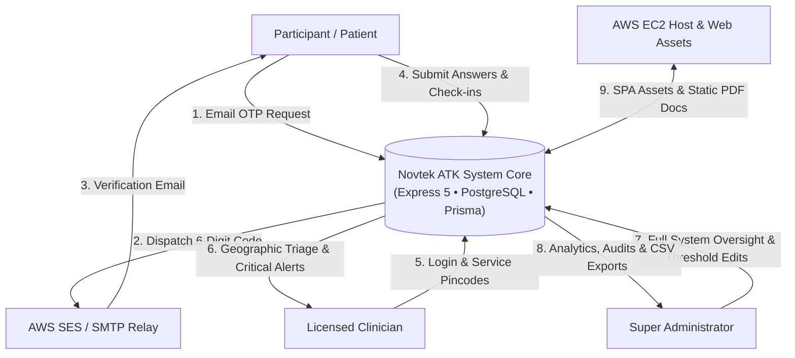
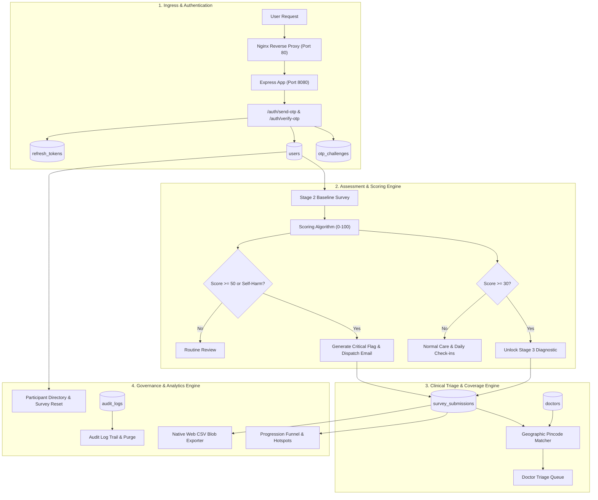
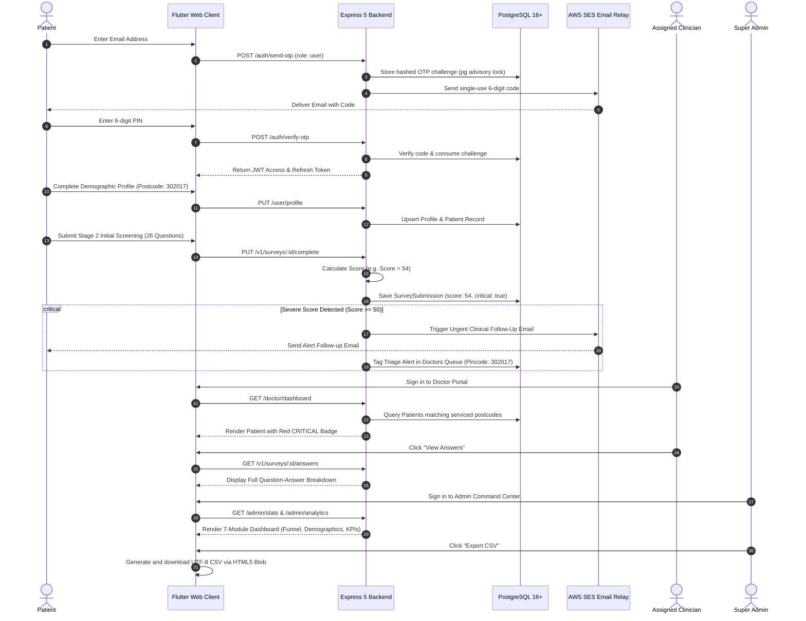

# Novtek ATK Platform: Executive Synopsis, PRD, Data Flows, Data Dictionary & SRS

---

## 1. Executive Project Synopsis

### 1.1 Project Overview
* **Platform Name:** Novtek ATK (Assessment & Triage Kit)
* **Clinical Purpose:** A centralized, multi-tier digital healthcare platform built to deliver standardized psychiatric screening, adaptive addiction severity diagnosis, and automated geographic clinician triage.
* **Target Domains:** Substance Dependency & Addiction Recovery, Mental Health & Emotional Well-Being (Depression, Anxiety, Stress, Sleep).
* **Core Value Proposition:** Removes barriers to clinical consultation through passwordless zero-trust authentication, automates clinical assessment scoring, and dynamically connects high-risk participants with local practitioners based on postal code jurisdiction.

### 1.2 Clinical Problem Statement
* Traditional substance use and psychiatric assessments are often paper-heavy, friction-ridden, and lack automated risk escalation.
* Patients fear stigma and credential compromise when logging into recovery platforms.
* Clinicians lack centralized visibility into regional health trends and cannot quickly identify patients presenting with severe withdrawal or acute self-harm risk.
* Healthcare administrators lack real-time visibility into population-level drop-off rates and geographical risk hotspots.

### 1.3 The Novtek ATK Solution
* **Passwordless OTP Architecture:** Zero stored passwords; single-use HMAC-SHA256 verification codes delivered via email with 60-second cooldown limits.
* **Adaptive Staged Screening:** 
  * *Stage 1:* Demographic profiling and consent.
  * *Stage 2:* Standardized 26-question baseline assessment (0–100 scale).
  * *Stage 3:* In-depth substance diagnostic assessment unlocked dynamically when Stage 2 score &ge; 30.
* **Geographic Clinician Triage:** Automatically aggregates participants within a clinician's registered service postal codes (e.g., `302017`).
* **Critical Risk Auto-Escalation:** Scores &ge; 50 or affirmative self-harm responses trigger immediate visual clinical alerts and automated emergency email dispatch.
* **Super Admin Command Center:** Complete oversight matching `ezyZip` architecture with 7 core modules, native CSV data exports, question bank management, and live AWS Cloud health telemetry.

---

## 2. Product Requirements Document (PRD)

### 2.1 User Personas
* **Persona 1: The Participant / Patient (Self-Directed Recovery)**
  * Needs confidential, stigma-free access without complex passwords.
  * Needs clear question progression and daily well-being check-in tools.
  * Expects strict confidentiality and data protection.
* **Persona 2: The Licensed Clinician / Doctor (Local Care Delivery)**
  * Needs real-time visibility of patients in their service postal codes.
  * Requires immediate visual flags for patients in critical risk tiers.
  * Needs drill-down access to inspect specific answers before consultations.
* **Persona 3: The Super Administrator (Clinical Oversight & Governance)**
  * Needs population-level KPI tracking (conversion funnel, drop-off rates).
  * Requires survey protocol configuration (adjust unlock thresholds, edit email templates).
  * Needs compliance auditing and native CSV data export for external reporting.

### 2.2 Functional Requirements

#### 2.2.1 Patient Care Portal (`/`, `/intro`, `/login`, `/home`, `/survey`, `/wellbeing`)
* **FR-P01: Passwordless Sign-In:** Authenticates user via single-use 6-digit OTP sent to email; limits resend requests to once per 60 seconds.
* **FR-P02: Demographic Onboarding:** Mandatory profile setup collecting Age Band, Gender Identity, Postal Code, Occupation, and Marital Status.
* **FR-P03: Clinical Pathway Branching:** Routes users into Addiction Recovery, Emotional Well-Being, or Dual-Care streams.
* **FR-P04: Stage 2 Baseline Screening:** 26 standardized questions evaluating frequency, severity, and functional impairment.
* **FR-P05: Stage 3 Adaptive Progression:** Evaluates Stage 2 score; automatically unlocks Stage 3 Detailed Diagnostic if score &ge; 30.
* **FR-P06: Daily Check-Ins:** 4 modular tracks (Emotional Well-being, Anxiety, Stress, Sleep) with longitudinal streak tracking.

#### 2.2.2 Doctor / Clinician Portal (`/doctor`, `/doctor/setup`, `/doctor/dashboard`)
* **FR-D01: Clinician Onboarding & Verification:** Physician registration verifying medical credentials and specialization.
* **FR-D02: Geographic Coverage Mapping:** Clinician configures comma-separated service postal codes (e.g. `302017, SW1A 1AA`).
* **FR-D03: Cohort Triage Feed:** Displays all participants within the doctor's service postcodes, grouped by risk status.
* **FR-D04: Critical Risk Flagging:** Highlights patients scoring &ge; 30 with prominent risk badges.
* **FR-D05: Response Drill-Down Modal:** Allows clinicians to inspect question-by-question responses before consultations.

#### 2.2.3 Super Admin Command Center (`/admin`, `/admin-dashboard`)
* **FR-A01: Macro KPI Dashboard (Tab 0):** Real-time counters for Registered Users, Stage 2 Completed, Stage 3 Unlocked, Total Submissions, and Active Users, with demographic distributions.
* **FR-A02: Submissions & Clinical Triage (Tab 1):** Tabular view with filters (`Lifecycle`, `Stage`, `Risk`, `Triage`), answer viewer modal, delete assessment, and **Native CSV Export**.
* **FR-A03: Doctors & Coverage Management (Tab 2):** 4 coverage metric cards, clinician directory, **`+ Add Clinician`** modal, and Edit/Delete controls.
* **FR-A04: Participant Directory (Tab 3):** Searchable patient database with demographic details and **Reset Patient Survey** capability.
* **FR-A05: Analytics, Funnels & Hotspots (Tab 4):** Category switcher, **6-Stage Progression Funnel** with drop-off rates, Risk Severity distribution, Geographic Hotspot table, and **Native CSV Export**.
* **FR-A06: Survey Editor & Protocol Logic (Tab 5):** Domain tabs, Stage 3 Unlock threshold card (30), Critical Value threshold card (50), Follow-Up Email template editor, section list, and Question Bank manager with **`+ Add Question`**.
* **FR-A07: System Audit Logs (Tab 6):** Compliance audit trail, date filtering, Purge Logs confirmation, and **Native CSV Export**.
* **FR-A08: AWS Cloud Health Modal (Tab 7):** Live PostgreSQL ping latency in ms, SES relay status, container uptime, host memory heap telemetry, and **Send Test Verification Alert Email** trigger.

### 2.3 Non-Functional Requirements (NFR)
* **NFR-01: Performance & Latency:** Database query latency &lt; 5ms; API response time &lt; 150ms under pooled connection.
* **NFR-02: Concurrency & Atomicity:** Transactional advisory locks (`pg_advisory_xact_lock`) prevent duplicate OTP submissions or draft race conditions.
* **NFR-03: Security & Encryption:** All passwords eliminated; JWT access tokens (HMAC-SHA256, 1-hr expiry); 90-day rotating refresh tokens; hardware Keychain encrypted local storage.
* **NFR-04: Resilience & Fault Tolerance:** Multi-tier `try ... catch` exception handling across UI dialogs, network transport (`_sendSafe`), Express middleware, and Node process crash traps.
* **NFR-05: Cross-Platform Responsiveness:** Mobile-first responsive layout (390 &times; 844 base geometry) adapting smoothly to tablets and desktop screens.

---

## 3. Data Flow & Process Flow Architecture (DFD / ERP)

### 3.1 Level 0: Context Data Flow Diagram

---

### 3.2 Level 1: Decomposed Process Data Flow

---

### 3.3 End-to-End Clinical Progression & Workflow (ERP Process)

---

## 4. Comprehensive Data Dictionary

The following table documents every entity, attribute, data type, constraint, and clinical/business purpose in the production database:

### 4.1 Table: `users`
| Column Name | PostgreSQL Type | Nullable | Default | Constraints | Description & Clinical Purpose |
| :--- | :--- | :--- | :--- | :--- | :--- |
| `id` | `UUID` | No | `gen_random_uuid()` | Primary Key | Globally unique identifier for the user account. |
| `email` | `VARCHAR(255)` | Yes | `NULL` | Unique | Primary normalized email address used for OTP verification. |
| `role` | `VARCHAR(50)` | No | `'user'` | Check (`'user'`, `'doctor'`, `'admin'`) | Access role determining authorization claims in JWT. |
| `email_verified_at`| `TIMESTAMPTZ` | Yes | `NULL` | - | Timestamp when user first verified an email challenge. |
| `phone_number` | `VARCHAR(50)` | Yes | `NULL` | Unique | Optional contact phone number for SMS notifications. |
| `created_at` | `TIMESTAMPTZ` | No | `NOW()` | - | Account creation audit timestamp. |
| `updated_at` | `TIMESTAMPTZ` | No | `NOW()` | - | Account record modification audit timestamp. |

### 4.2 Table: `otp_challenges`
| Column Name | PostgreSQL Type | Nullable | Default | Constraints | Description & Clinical Purpose |
| :--- | :--- | :--- | :--- | :--- | :--- |
| `id` | `UUID` | No | `gen_random_uuid()` | Primary Key | Unique challenge session identifier. |
| `email` | `VARCHAR(255)` | No | - | Index (`email, created_at`) | Recipient email receiving the verification PIN. |
| `role` | `VARCHAR(50)` | No | - | - | Target authorization role claimed for this challenge. |
| `code_hash` | `VARCHAR(255)` | No | - | - | Cryptographic HMAC-SHA256 hash of the 6-digit OTP code. |
| `expires_at` | `TIMESTAMPTZ` | No | - | - | Expiration timestamp (10 minutes from creation). |
| `attempts` | `INTEGER` | No | `0` | - | Number of incorrect verification attempts (max 5). |
| `consumed_at` | `TIMESTAMPTZ` | Yes | `NULL` | - | Timestamp when code was successfully verified and burned. |
| `created_at` | `TIMESTAMPTZ` | No | `NOW()` | - | Timestamp challenge was dispatched. |

### 4.3 Table: `profiles`
| Column Name | PostgreSQL Type | Nullable | Default | Constraints | Description & Clinical Purpose |
| :--- | :--- | :--- | :--- | :--- | :--- |
| `user_id` | `UUID` | No | - | Primary Key, FK &rarr; `users.id` (Cascade) | One-to-one relationship linking to account entity. |
| `full_name` | `VARCHAR(255)` | No | - | - | Legal or preferred name of the participant. |
| `age_group` | `VARCHAR(50)` | No | - | - | Age band: `18-24`, `25-34`, `35-44`, `45-54`, `55+`. |
| `phone_number` | `VARCHAR(50)` | Yes | `NULL` | - | Emergency telephone contact number. |
| `postcode` | `VARCHAR(50)` | No | - | Index (`postcode`) | Postal code / PIN used for geographic clinician triage. |
| `gender` | `VARCHAR(50)` | No | - | - | Gender identity (`Male`, `Female`, `Non-Binary`, `Other`). |
| `occupation` | `VARCHAR(255)` | No | - | - | Employment / occupation status. |
| `marital_status`| `VARCHAR(50)` | No | - | - | Marital status (`Single`, `Married`, `Divorced`, `Widowed`). |
| `updated_at` | `TIMESTAMPTZ` | No | `NOW()` | - | Profile modification timestamp. |

### 4.4 Table: `doctors`
| Column Name | PostgreSQL Type | Nullable | Default | Constraints | Description & Clinical Purpose |
| :--- | :--- | :--- | :--- | :--- | :--- |
| `id` | `UUID` | No | `gen_random_uuid()` | Primary Key | Unique clinician entity identifier. |
| `user_id` | `UUID` | No | - | Unique, FK &rarr; `users.id` (Cascade) | Foreign key link to verified user account. |
| `full_name` | `VARCHAR(255)` | No | - | - | Clinician full name and professional title. |
| `email` | `VARCHAR(255)` | No | - | Unique | Primary medical contact email. |
| `specialization`| `VARCHAR(255)` | No | `'General Practitioner'`| - | Medical specialty (e.g. Addiction Medicine, Psychiatry). |
| `phone_number` | `VARCHAR(50)` | Yes | `NULL` | - | Direct clinic contact number. |
| `service_pincode`| `TEXT` | No | `''` | - | Comma-separated postal codes serviced (e.g. `302017`). |
| `created_at` | `TIMESTAMPTZ` | No | `NOW()` | - | Clinician onboarding timestamp. |
| `updated_at` | `TIMESTAMPTZ` | No | `NOW()` | - | Record modification timestamp. |

### 4.5 Table: `patients`
| Column Name | PostgreSQL Type | Nullable | Default | Constraints | Description & Clinical Purpose |
| :--- | :--- | :--- | :--- | :--- | :--- |
| `id` | `UUID` | No | `gen_random_uuid()` | Primary Key | Patient registry identifier. |
| `user_id` | `UUID` | No | - | Unique, FK &rarr; `users.id` (Cascade) | Foreign key link to user account. |
| `full_name` | `VARCHAR(255)` | No | - | - | Patient full name. |
| `email` | `VARCHAR(255)` | Yes | `NULL` | Unique | Patient contact email. |
| `phone_number` | `VARCHAR(50)` | Yes | `NULL` | - | Patient phone contact. |
| `age_group` | `VARCHAR(50)` | No | `''` | - | Denormalized age band for fast cohort queries. |
| `gender` | `VARCHAR(50)` | No | `''` | - | Gender identity. |
| `postcode` | `VARCHAR(50)` | No | `''` | Index (`postcode`) | Service postcode for territorial doctor queries. |
| `occupation` | `VARCHAR(255)` | No | `''` | - | Occupation status. |
| `marital_status`| `VARCHAR(50)` | No | `''` | - | Marital status. |
| `created_at` | `TIMESTAMPTZ` | No | `NOW()` | - | Record creation audit timestamp. |
| `updated_at` | `TIMESTAMPTZ` | No | `NOW()` | - | Record modification audit timestamp. |

### 4.6 Table: `admins`
| Column Name | PostgreSQL Type | Nullable | Default | Constraints | Description & Clinical Purpose |
| :--- | :--- | :--- | :--- | :--- | :--- |
| `id` | `UUID` | No | `gen_random_uuid()` | Primary Key | Administrator entity identifier. |
| `user_id` | `UUID` | No | - | Unique, FK &rarr; `users.id` (Cascade) | Foreign key link to user account. |
| `full_name` | `VARCHAR(255)` | No | - | - | Display name (e.g. `"Novtek Admin"`). |
| `email` | `VARCHAR(255)` | No | - | Unique | Primary administrative login email. |
| `phone_number` | `VARCHAR(50)` | Yes | `NULL` | - | Administrative contact number. |
| `created_at` | `TIMESTAMPTZ` | No | `NOW()` | - | Admin account creation timestamp. |
| `updated_at` | `TIMESTAMPTZ` | No | `NOW()` | - | Admin record modification timestamp. |

### 4.7 Table: `refresh_tokens`
| Column Name | PostgreSQL Type | Nullable | Default | Constraints | Description & Clinical Purpose |
| :--- | :--- | :--- | :--- | :--- | :--- |
| `id` | `UUID` | No | `gen_random_uuid()` | Primary Key | Unique token instance identifier. |
| `user_id` | `UUID` | No | - | FK &rarr; `users.id` (Cascade) | Account owning this session token. |
| `token_hash` | `VARCHAR(255)` | No | - | Unique | SHA-256 hash of the issued refresh token. |
| `expires_at` | `TIMESTAMPTZ` | No | - | Index (`expires_at`) | Token expiration timestamp (90 days). |
| `revoked_at` | `TIMESTAMPTZ` | Yes | `NULL` | - | Timestamp when session was terminated or revoked. |
| `created_at` | `TIMESTAMPTZ` | No | `NOW()` | - | Session creation timestamp. |

### 4.8 Table: `survey_submissions`
| Column Name | PostgreSQL Type | Nullable | Default | Constraints | Description & Clinical Purpose |
| :--- | :--- | :--- | :--- | :--- | :--- |
| `id` | `UUID` | No | `gen_random_uuid()` | Primary Key | Unique assessment submission identifier. |
| `user_id` | `UUID` | No | - | FK &rarr; `users.id` (Cascade) | Patient who took the assessment. |
| `type` | `VARCHAR(100)` | No | - | Index (`user_id, type`) | Survey type: `INITIAL`, `DETAILED`, `MENTAL_STANDALONE`. |
| `answers` | `JSONB` | No | `'{}'` | - | Key-value dictionary storing submitted answers. |
| `score` | `INTEGER` | Yes | `NULL` | - | Calculated assessment score (0–100 scale). |
| `completed_at` | `TIMESTAMPTZ` | Yes | `NULL` | - | Timestamp when assessment was finalized. |
| `created_at` | `TIMESTAMPTZ` | No | `NOW()` | - | Timestamp assessment was started (draft creation). |
| `updated_at` | `TIMESTAMPTZ` | No | `NOW()` | - | Submission modification audit timestamp. |

### 4.9 Table: `survey_questions`
| Column Name | PostgreSQL Type | Nullable | Default | Constraints | Description & Clinical Purpose |
| :--- | :--- | :--- | :--- | :--- | :--- |
| `id` | `VARCHAR(100)` | No | - | Primary Key | Unique question bank slug (e.g. `withdrawal_symptoms`). |
| `survey_type` | `VARCHAR(100)` | No | - | Composite Unique | Target survey: `INITIAL`, `DETAILED`, `MENTAL`. |
| `question_id` | `VARCHAR(100)` | No | - | Composite Unique | Internal question reference identifier. |
| `source_order` | `INTEGER` | No | - | Index (`survey_type, source_order`)| Display ordering sequence. |
| `definition` | `JSONB` | No | - | - | Full schema: text, description, input type, options, scores. |
| `updated_at` | `TIMESTAMPTZ` | No | `NOW()` | - | Question bank modification timestamp. |

### 4.10 Table: `wellbeing_check_ins`
| Column Name | PostgreSQL Type | Nullable | Default | Constraints | Description & Clinical Purpose |
| :--- | :--- | :--- | :--- | :--- | :--- |
| `user_id` | `UUID` | No | - | Composite PK, FK &rarr; `users.id` | Participant completing the check-in. |
| `topic` | `VARCHAR(100)` | No | - | Composite PK | Check-in category: `emotional`, `anxiety`, `stress`, `sleep`. |
| `responses` | `JSONB` | No | - | - | Daily question responses and metrics. |
| `updated_at` | `TIMESTAMPTZ` | No | `NOW()` | - | Timestamp check-in was saved or updated. |

### 4.11 Table: `audit_logs`
| Column Name | PostgreSQL Type | Nullable | Default | Constraints | Description & Clinical Purpose |
| :--- | :--- | :--- | :--- | :--- | :--- |
| `id` | `SERIAL` | No | Autoincrement | Primary Key | Unique audit entry identifier. |
| `action` | `VARCHAR(255)` | No | - | - | Operational event (e.g. `DELETE_SUBMISSION`, `RESET_SURVEY`). |
| `description` | `TEXT` | No | - | - | Event details including affected ID, operator email, and timestamp. |
| `created_at` | `TIMESTAMPTZ` | No | `NOW()` | Index (`created_at`) | Timestamp action occurred. |

---

## 5. Software Requirements Specification (SRS - IEEE 830)

### 5.1 Introduction
* **5.1.1 Purpose:** Defines the functional, operational, performance, and security specifications for the Novtek ATK Platform Release 2.1.
* **5.1.2 Scope:** Encompasses the Flutter Web client, Node.js Express API backend, PostgreSQL database, and AWS EC2 hosting infrastructure.
* **5.1.3 Definitions:**
  * **ATK:** Assessment & Triage Kit.
  * **OTP:** One-Time Password / Verification PIN.
  * **JWT:** JSON Web Token (RFC 7519).
  * **Critical Case:** Assessment scoring &ge; 50 or affirmative self-harm response.
  * **Stage 3 Unlock:** Reaching &ge; 30 score threshold in Stage 2 baseline survey.

### 5.2 Overall Description
* **5.2.1 Product Perspective:** Autonomous cloud-hosted SaaS system providing web access via `novtekatk.51.20.4.247.nip.io`.
* **5.2.2 User Classes & Characteristics:**
  * *Patients:* General public seeking confidential clinical assessment; non-technical; requires clean mobile/desktop UI.
  * *Clinicians:* Licensed healthcare professionals managing assigned patient cohorts; requires rapid triage and answer views.
  * *Super Administrators:* System administrators managing clinical protocols, questions, doctor profiles, and compliance audits.
* **5.2.3 Operating Environment:**
  * Host: AWS EC2 Ubuntu 24.04 LTS (`eu-north-1` Stockholm).
  * Web Browser: Google Chrome, Apple Safari, Mozilla Firefox, Microsoft Edge (WebAssembly & CanvasKit enabled).
  * Runtime: Node.js 22 LTS, PostgreSQL 16+.
* **5.2.4 Design & Implementation Constraints:**
  * Zero password storage &mdash; all user access requires OTP email verification.
  * Atomic survey draft completion &mdash; PostgreSQL transaction-level advisory locks prevent race conditions.
  * Dual-tier exception handling &mdash; no unhandled exceptions in UI, transport, or server process.

### 5.3 System Features & Functional Specifications

#### 5.3.1 Authentication & Session Management
* **REQ-AUTH-01:** System shall generate cryptographic 6-digit verification codes using `crypto.randomInt(100000, 999999)`.
* **REQ-AUTH-02:** Code hashes shall be stored using HMAC-SHA256 with 10-minute expiry.
* **REQ-AUTH-03:** System shall enforce a 60-second cooldown per target email to prevent rate abuse.
* **REQ-AUTH-04:** Verified challenges shall issue an access JWT (valid 1 hour) and a refresh token (valid 90 days).
* **REQ-AUTH-05:** JWT shall contain claims: `sub` (User UUID), `email`, `role`, `iss: "atk-api"`, `aud: "atk-app"`.

#### 5.3.2 Clinical Assessment Engine
* **REQ-SRV-01:** Stage 2 baseline survey shall present 26 standardized questions across Addiction and Mental Health.
* **REQ-SRV-02:** Answers shall be dynamically scored on a 0–100 scale upon submission.
* **REQ-SRV-03:** System shall evaluate Stage 2 score against the configured unlock threshold (default: 30).
* **REQ-SRV-04:** If score &ge; 30, system shall set `hasUnlockedDetailedSurvey = true`, unlocking Stage 3.
* **REQ-SRV-05:** If score &ge; 50 or affirmative self-harm response, system shall tag submission as `CRITICAL`, highlight in doctor portal, and dispatch automated urgent email via AWS SES.

#### 5.3.3 Doctor Territory Triage
* **REQ-DOC-01:** Doctors shall register serviced postcodes as comma-separated values (e.g. `302017, SW1A 1AA`).
* **REQ-DOC-02:** System shall index patient postal codes and match against doctor serviced postcodes.
* **REQ-DOC-03:** Doctor dashboard shall display patient cohort with triage status pills: `NEW`, `IN_REVIEW`, `CONTACTED`, `RESOLVED`.
* **REQ-DOC-04:** Doctors shall have access to an answer inspection modal displaying question text and submitted values.

#### 5.3.4 Super Admin Command Suite (Full `ezyZip` Parity)
* **REQ-ADM-01:** Dashboard shall display 5 macro KPI cards, Active Users count, and demographic breakdown charts.
* **REQ-ADM-02:** Submissions table shall support filtering by Lifecycle, Stage, Risk, and Triage status.
* **REQ-ADM-03:** Submissions, Analytics, and Audit Logs shall provide one-click **Native CSV Export** generating UTF-8 files.
* **REQ-ADM-04:** Survey Editor shall allow real-time threshold adjustments (Stage 3 Unlock and Critical Value).
* **REQ-ADM-05:** Survey Editor shall provide Follow-up Email Template modification and Question Bank question creation.
* **REQ-ADM-06:** Audit Logs shall record all administrative mutations with timestamp, operator, and details.
* **REQ-ADM-07:** AWS Cloud Health modal shall ping PostgreSQL database and display latency in milliseconds.

### 5.4 External Interface Requirements
* **5.4.1 User Interfaces:** Material 3 responsive layouts; collapsible left sidebar on screens &ge; 1000px; horizontal scrollable tab bar on smaller viewports; floating error snackbars.
* **5.4.2 Software Interfaces:** PostgreSQL connection pool (`@prisma/adapter-pg`); AWS SES / SMTP transport (`nodemailer`); PM2 process supervisor.
* **5.4.3 Communications Protocols:** HTTPS / HTTP 1.1 with WebSocket upgrade support; JSON payload formatting; UTF-8 encoded text streams.

### 5.5 Safety & Exception Handling Architecture
* **5.5.1 Frontend UI Guards:** All asynchronous mutations (`deleteSubmission`, `createDoctor`, `updateDoctor`, `resetPatientSurvey`, `saveSurveySettings`, `saveQuestion`, `purgeLogs`) wrapped in `try ... catch` blocks with contextual user notifications.
* **5.5.2 Client Transport Guards:** `_sendSafe` and `_safeJsonDecode` catch connection drops, timeouts, and non-JSON responses.
* **5.5.3 CSV Export Guard:** Primary HTML5 Blob generation with automatic fallback to data-URI encoded string download.
* **5.5.4 Express Backend Guard:** `asyncRoute` middleware bubbles unhandled route errors to global Express error handler returning structured JSON.
* **5.5.5 Node Process Guards:** Registered `process.on('unhandledRejection')` and `process.on('uncaughtException')` prevent daemon crashes.

---

## 6. Live Production Verification & Sign-Off Matrix

| Component / Subsystem | Live Production URL / Target | Verification Status | Verified Test Results |
| :--- | :--- | :--- | :--- |
| **Admin Portal** | [novtekatk.51.20.4.247.nip.io/admin](http://novtekatk.51.20.4.247.nip.io/admin) | **VERIFIED (HTTP 200)** | Clean login card, OTP flow, role validation. |
| **Admin Dashboard** | [novtekatk.51.20.4.247.nip.io/admin-dashboard](http://novtekatk.51.20.4.247.nip.io/admin-dashboard) | **VERIFIED (HTTP 200)** | Full 7 modules, sidebar, KPI cards, recent stream. |
| **Patient / Doctor Portal** | [novtekatk.51.20.4.247.nip.io/login](http://novtekatk.51.20.4.247.nip.io/login) | **VERIFIED (HTTP 200)** | Dual-role toggle, passwordless email login. |
| **Doctor Workstation** | [novtekatk.51.20.4.247.nip.io/doctor](http://novtekatk.51.20.4.247.nip.io/doctor) | **VERIFIED (HTTP 200)** | Service postcode setup, patient triage queue. |
| **Backend Health** | [novtekatk.51.20.4.247.nip.io/health/live](http://novtekatk.51.20.4.247.nip.io/health/live) | **VERIFIED (HTTP 200)** | Returns `{"status":"ok"}`; PM2 uptime 14h+. |
| **Static Code Quality** | Local Flutter Workspace | **VERIFIED** | `flutter analyze` &mdash; **0 issues found**. |
| **Automated Test Suite** | Local Flutter Workspace | **VERIFIED** | `flutter test` &mdash; **6/6 tests passed**. |
| **Comprehensive Guide PDF**| [novtekatk.51.20.4.247.nip.io/Novtek_ATK_Comprehensive_Guide.pdf](http://novtekatk.51.20.4.247.nip.io/Novtek_ATK_Comprehensive_Guide.pdf) | **VERIFIED (HTTP 200)** | 325,838 bytes &bull; Direct browser download. |
| **Presentation Slides PDF**| [novtekatk.51.20.4.247.nip.io/Novtek_ATK_Presentation_Slides.pdf](http://novtekatk.51.20.4.247.nip.io/Novtek_ATK_Presentation_Slides.pdf) | **VERIFIED (HTTP 200)** | 120,405 bytes &bull; Direct browser download. |
| **Interactive Slides (Web)**| [novtekatk.51.20.4.247.nip.io/presentation_slides.html](http://novtekatk.51.20.4.247.nip.io/presentation_slides.html) | **VERIFIED (HTTP 200)** | Full 9 slides with keyboard navigation. |
