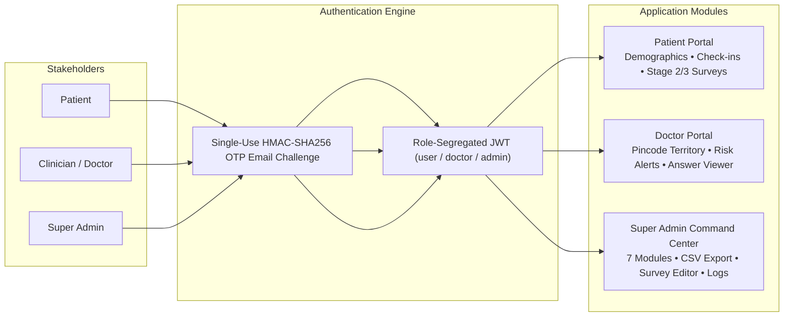
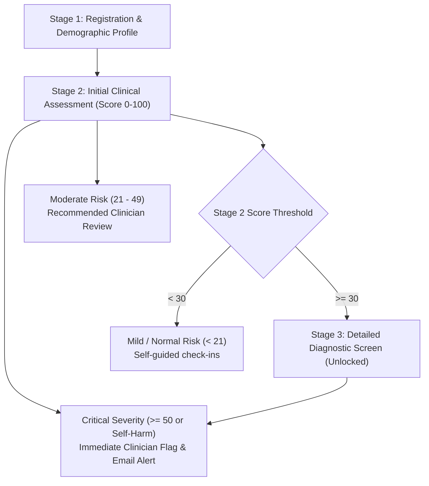

# Novtek ATK — Technical Architecture & Project Summary

## 1. Executive Project Summary

- **Clinical Mission:** Novtek ATK (Assessment & Triage Kit) is an evidence-based clinical screening, triage, and longitudinal well-being platform designed to facilitate early identification, confidential tracking, and geographic clinician triage of substance dependency and mental health conditions.
- **Three Dedicated Stakeholder Portals:**
  1. **Patient Portal (`/`, `/intro`, `/login`, `/home`, `/survey`, `/wellbeing`):** Passwordless onboarding, baseline demographic setup, Stage 2 Initial Screening (26 questions across Addiction & Mental Health), Stage 3 Detailed Diagnostic evaluations (unlocked based on clinical score thresholds), daily well-being check-ins, and confidential streak tracking.
  2. **Doctor / Clinician Portal (`/doctor`, `/doctor/setup`, `/doctor/dashboard`):** Real-time clinical triage workstation enabling licensed practitioners to monitor participants residing within their designated service postcodes/pincodes, review detailed question-by-question responses, and track critical clinical risk flags (&ge; 30 score).
  3. **Super Admin Clinical Command Center (`/admin`, `/admin-dashboard`):** Replicating the complete `ezyZip` architecture with 7 core operational modules: Dashboard KPIs, Submissions & Clinical Triage with Native CSV Export, Clinicians & Coverage Management, Participant Directory with survey reset capability, Population Analytics & Trends with 6-Stage Progression Funnel & CSV Export, Survey Editor & Protocol Logic (thresholds, email templates, question bank), System Audit Logs with CSV Export, and Live AWS Cloud Health telemetry.
- **Zero-Trust Security & Concurrency Safety:** Single-use HMAC-SHA256 OTP verification codes, 60-second target cooldowns, short-lived JWT access tokens with refresh token rotation, and PostgreSQL advisory transaction locks (`pg_advisory_xact_lock`) ensuring atomic draft completion without race conditions.
- **End-to-End Exception Handling:** Comprehensive dual-tier `try ... catch` architecture safeguarding all UI dialogs, mutations, CSV downloads, network transport, Express API routes, and Node.js process-level exception handlers.

---

## 2. Complete Technology Stack Matrix

### 2.1 Frontend Tech Stack (Flutter Web, Mobile & Desktop)

| Layer / Component | Technology & Package | Version | Purpose & Implementation Details |
|---|---|---|---|
| **Core Framework** | `Flutter SDK` (Dart 3.14+) | `^3.24.0` | Cross-platform client compiling natively to Web (CanvasKit/HTML5), macOS, iOS, and Android from a single unified codebase. |
| **State Management** | `flutter_bloc` | `^9.1.1` | Predictable, reactive Cubit architecture managing discrete flows (`LoginCubit`, `IntroCubit`, `WellbeingCubit`, `HomeCubit`, `AddictionDashboardCubit`). |
| **Responsive Geometry** | `flutter_screenutil` | `^5.9.3` | Fluid design geometry with base reference `390 × 844`, adapting automatically between small smartphones, tablets, landscape screens, and large desktop monitors. |
| **Design System & UI** | `material_ui` / `cupertino_ui` | `^1.1.0` | Custom Material 3 healthcare theme: Slate 900 (`#0F172A`), Indigo 600 (`#4F46E5`), Emerald 600 (`#059669`), Rose 600 (`#E11D48`), and Light Canvas (`#F8FAFC`). |
| **Secure Storage** | `flutter_secure_storage` + `AppStorage` | `^9.2.4` | Hardware Keychain/Keystore encrypted storage with seamless fallback to browser `localStorage` and memory in non-HTTPS / IP-based development contexts. |
| **CSV Export Engine** | `dart:html` / `csv_exporter_web.dart` | Custom | Native browser HTML5 `Blob` and `AnchorElement` trigger downloading UTF-8 CSVs directly to disk with fallback to data-URI encoded streaming. |
| **HTTP Transport** | `http` | `^1.5.0` | Centralized `ApiClient` and `AdminService` with dynamic origin resolution (`Uri.base.origin`), JWT header injection, automatic 401 token refresh interception, and timeout guards. |
| **Icons & Typography** | `material_icons` / `cupertino_icons` | `^1.0.8` | High-fidelity iconography representing medical triage, assessments, analytics graphs, and cloud diagnostics. |

### 2.2 Backend Tech Stack (Node.js & Express)

| Component | Technology | Version | Purpose & Implementation Details |
|---|---|---|---|
| **Runtime Environment** | `Node.js` (LTS) | `>= 22.18` | Modern ES-Module runtime executing asynchronous, non-blocking I/O with native `fetch` and crypto acceleration. |
| **Web Framework** | `Express` | `^5.1.0` | Fast, minimalist HTTP server utilizing async route wrappers (`asyncRoute`) that automatically bubble unhandled errors to global middleware. |
| **Database Engine** | `PostgreSQL` | `16+` | Enterprise relational database utilizing connection pooling via `pg.Pool` for high-throughput queries and ACID transactions. |
| **ORM & Data Layer** | `Prisma ORM` | `^7.10.1` | Type-safe client generation, migration management, and schema definitions for users, profiles, doctors, patients, survey submissions, and audit logs. |
| **Connection Pooling** | `@prisma/adapter-pg` | `^7.10.1` | Native PostgreSQL connection adapter providing sub-millisecond connection reuse and query pipeline execution. |
| **Concurrency Guard** | `pg_advisory_xact_lock` | Native PG | Transactional advisory locks preventing concurrent duplicate survey completions and double OTP verifications. |
| **Authentication & Tokens** | `jsonwebtoken` / `crypto` | `^9.0.2` | Cryptographic HMAC-SHA256 signed JWTs with 1-hour access validity, role segregation (`user`, `doctor`, `admin`), and 90-day rotating refresh tokens. |
| **Schema Validation** | `zod` | `^4.1.5` | Strict runtime payload verification ensuring email formats, numeric scores, survey response maps, and doctor postal codes conform to specifications. |
| **Security Headers** | `helmet` | `^8.1.0` | Automatic injection of security headers (CSP, HSTS, X-Content-Type-Options, Frameguard, Referrer-Policy). |
| **Rate Limiting** | `express-rate-limit` | `^8.1.0` | Strict brute-force deterrence: 5 OTP verification attempts per hour and 60-second cooldown per target recipient email. |
| **Email Transport** | `nodemailer` | `^10.6.0` | Transactional email relay configured for AWS SES (Simple Email Service) / SMTP delivering single-use 6-digit verification codes. |
| **Process Manager** | `PM2` | `^5.4.0` | Production daemon supervisor managing `novtek-atk` with auto-restart on memory limits, log rotation, and systemd persistence. |

### 2.3 Cloud & Infrastructure Tech Stack (AWS EC2)

| Layer | AWS Service / Tool | Configuration & Details |
|---|---|---|
| **Compute Instance** | `AWS EC2` | Ubuntu 24.04 LTS, Region `eu-north-1` (Stockholm), Public IP `51.20.4.247`. |
| **Reverse Proxy** | `Nginx 1.28` | Listens on Port 80; reverse-proxies to Node.js backend on Port 8080 with WebSocket upgrade support, Gzip compression, and client buffer optimization. |
| **DNS & Routing** | `nip.io Wildcard DNS` | Resolves `novtekatk.51.20.4.247.nip.io` directly to EC2 host IP without requiring manual DNS nameserver propagation. |
| **Static File Delivery** | Express `express.static` | Serves compiled Flutter Web single-page application bundle (`../app/build/web`) directly from disk with SPA HTML5 fallback routing. |
| **Diagnostics & Health** | Custom Telemetry Routes | `/health/live` (process health), `/health/ready` (PostgreSQL ping), `/admin/diagnostics` (memory heap, uptime, DB latency). |

---

## 3. The 3 Core Portals & Clinical Roles



### 3.1 Patient Portal
- **Onboarding:** Passwordless OTP sign-in with 60-second countdown; demographic questionnaire capturing age band, gender identity, postcode, occupation, and marital status.
- **Stage 2 Initial Assessment:** Standardized baseline screening across Addiction and Mental Health assessing substance frequency, emotional impact, and risk indicators.
- **Stage 3 Detailed Clinical Screening:** Unlocks dynamically when Stage 2 score meets or exceeds the clinical qualification threshold (30).
- **Daily Well-Being Check-Ins:** Four specialized modules (Emotional Well-being, Anxiety & Worry, Stress Management, Sleep Hygiene) with longitudinal streak tracking.

### 3.2 Doctor / Clinician Portal
- **Geographic Coverage Matching:** Doctors specify their serviced postcodes/pincodes (e.g. `302017`). The platform aggregates matching participants into their active roster.
- **Critical Risk Alerts:** Highlights patients with assessment scores &ge; 30 with immediate clinical risk alerts.
- **Assessment Response Viewer:** Full drill-down modal inspecting each question and submitted answer to inform clinical consultations.

### 3.3 Super Admin Command Center (The 7 Modules)
1. **Clinical Command Dashboard:** Macro KPI metric cards (Registered Users, Stage 2 Completed, Stage 3 Unlocked, Total Submissions, Active Users), demographic distributions (Age, Gender, Marital Status), and recent assessment submissions stream.
2. **Submissions & Clinical Triage:** Filterable assessment registry with filter pills (`Lifecycle`, `Stage`, `Risk`, `Triage`), question-by-question response modal, deletion control, and **Native CSV Export**.
3. **Doctors & Clinician Coverage:** 4 summary metric cards, searchable directory with specializations and serviced pincodes, **`+ Add Clinician`** modal dialog, and Edit/Delete controls.
4. **Participant Directory:** Complete patient registry with demographic profiles, contact details, and **Reset Patient Survey** action.
5. **Analytics, Funnels & Hotspots:** Domain switcher (`All Categories`, `Addiction`, `Mental Health`), **6-Stage Clinical Progression Funnel** with cohort drop-off percentages, Risk Severity breakdown, Geographic Hotspot table by pincode, and **Native CSV Export**.
6. **Survey Editor & Protocol Logic:** Domain switcher (`Addiction` vs `Mental Health`), **Stage 3 Unlock threshold card (30)**, **Critical Value threshold card (50)**, Edit Follow-Up Email template modal, section organizer, and Question Bank manager with **`+ Add Question`**.
7. **System Audit & Security Logs:** Comprehensive compliance log trail with date filter, **Purge Logs** action, and **Native CSV Export**.
8. **AWS Cloud Health Modal:** Live PostgreSQL latency ping in milliseconds, SES/SMTP email relay status, host memory heap telemetry, container uptime, and **"Send Test Verification Alert Email"** trigger.

---

## 4. Clinical Protocol & Scoring Architecture



- **Stage 2 Baseline:** 26 standardized questions scored on a 0–100 scale.
- **Stage 3 Qualification Threshold:** Set at **30** (configurable in Survey Editor). Scores &ge; 30 unlock the detailed diagnostic assessment.
- **Critical Risk Threshold:** Set at **50** (configurable in Survey Editor) or affirmative response to self-harm risk questions.
  - Automatically tags submission with red `CRITICAL` badge.
  - Generates immediate notification to clinicians covering the patient's postal code.
  - Triggers automated urgent follow-up clinical email dispatch via AWS SES / SMTP.

---

## 5. End-to-End Exception Handling & Resilience Architecture

The codebase enforces a comprehensive dual-tier `try ... catch` exception handling strategy:

### 5.1 Flutter Frontend Error Handling
- **UI Action Layer:** All asynchronous mutations (`deleteSubmission`, `deleteDoctor`, `createDoctor`, `updateDoctor`, `resetPatientSurvey`, `saveSurveySettings`, `saveQuestion`, `purgeLogs`, `sendTestEmail`) are enclosed in dedicated `try ... catch` blocks displaying localized user feedback via `ScaffoldMessenger` without dropping view state.
- **Network Transport Layer (`AdminService` & `ApiClient`):**
  - `_sendSafe()` catches `SocketException`, `ClientException`, and timeouts, translating raw errors into clean user-facing exception messages.
  - `_safeJsonDecode()` guards against non-JSON server responses (such as HTML error pages) to prevent uncaught `FormatException`.
  - Automatic 401 token refresh interception with secure re-authentication retry.
- **CSV Exporter Layer (`CsvExporter` & `downloadCsvWeb`):**
  - Primary HTML5 Web `Blob` and `AnchorElement` trigger.
  - Secondary fallback to direct data-URI encoding (`data:text/csv;charset=utf-8,...`) if browser security prevents blob object URL creation.
- **Storage Layer (`AppStorage`):**
  - Enclosed in `try ... catch` to prevent browser cryptographic failure in non-HTTPS / IP-based contexts by automatically falling back to web `localStorage` and in-memory cache.

### 5.2 Backend Node.js / Express Error Handling
- **Async Route Wrapper (`asyncRoute`):** Wraps every Express route handler to guarantee all promise rejections are passed to `next(err)`.
- **Global Express Error Middleware:** Catches all application errors and delivers structured JSON responses:
  ```json
  { "error": "Descriptive message or sanitized error" }
  ```
- **Process Level Guards:** Registered `process.on('unhandledRejection')` and `process.on('uncaughtException')` listeners on the Node server to prevent unhandled background task or timer rejections from terminating the PM2 daemon.

---

## 6. Execution Commands & Quick Start Reference

### 6.1 Local Backend

Follow the [local backend setup](../README.md#start-the-backend-locally) to run the Node.js server with SQLite.

### 6.2 Frontend Commands (Flutter Web & Mobile)

```bash
# Fetch dependencies & verify static analysis (0 errors)
cd app && flutter pub get
flutter analyze

# Run automated test suite (6/6 tests passing)
flutter test

# Run Web locally against local backend
flutter run -d chrome --dart-define=ATK_API_URL=http://localhost:8080

# Build production Web release
flutter build web --release --no-tree-shake-icons

# Deploy build to AWS EC2
rsync -avz --delete -e "ssh -i atk-key.pem" build/web/ ubuntu@51.20.4.247:/home/ubuntu/atk/app/build/web/
```

---

## 7. Live Production Verification URLs

* **Admin Portal (Authentication):** [http://novtekatk.51.20.4.247.nip.io/admin](http://novtekatk.51.20.4.247.nip.io/admin)
* **Clinical Admin Command Dashboard:** [http://novtekatk.51.20.4.247.nip.io/admin-dashboard](http://novtekatk.51.20.4.247.nip.io/admin-dashboard)
* **Patient & Doctor Sign-In Portal:** [http://novtekatk.51.20.4.247.nip.io/login](http://novtekatk.51.20.4.247.nip.io/login)
* **Doctor Clinical Workstation:** [http://novtekatk.51.20.4.247.nip.io/doctor](http://novtekatk.51.20.4.247.nip.io/doctor)
* **Backend API Health Check:** [http://novtekatk.51.20.4.247.nip.io/health/live](http://novtekatk.51.20.4.247.nip.io/health/live)
